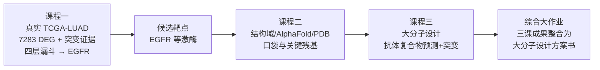

# 计算药学实践课程包（bio-class）

面向本科高年级（生物/药学）三门计算实验课的完整教学资源：教案、讲义大纲、学生实操手册、教师准备清单、示例数据、教学用脚本与素材。

## 课程总览

| 课程 | 课时 | 核心问题 | 主要工具 | 随堂产出 |
|---|---|---|---|---|
| 课程一《基于组学的致病机制解析与靶点发现实践》 | 4 学时 | 从真实组学数据中找到"哪个基因值得做成药靶点" | RStudio（云电脑）、GDC 数据门户、Enrichr/GEPIA2 网页端（备选） | 差异基因火山图、富集结果、突变证据、候选靶点报告 |
| 课程二《靶点确证与结构预测实践》 | 4 学时 | 从序列到结构，靶点的结构证据是否成立 | UniProt、AlphaFold DB、PDB、PyMOL | 靶蛋白结构档案（结构域、口袋、关键残基） |
| 课程三《人工智能大分子药物设计实践》 | 4 学时 | 从实验表位约束出发设计新的 mini-protein binder | RFdiffusion/ColabDesign、ProteinMPNN、ColabFold或在线Boltz、PyMOL、PDB（1YY9） | 界面约束表、backbone筛选、序列候选、回折复核、实验验证计划 |

## 三课联动主线：非小细胞肺癌（NSCLC）→ EGFR

三门课使用同一条"发现—确证—设计"的科研主线，首尾衔接：



- 课程一用真实 TCGA-LUAD 子集（15 肿瘤 vs 15 癌旁）做差异表达 + 通路富集 + 突变证据整合；EGFR 的表达并不显著，它靠 2/15 例激活突变与"细胞表面 + 变异类型匹配获批药"两层过滤（19del、L858R）进入候选名单——这本身就是课程的关键判断训练；
- 课程二对 EGFR 做序列注释、AlphaFold 结构评估、基于 PDB 结合模式的相互作用分析；
- 课程三面向 EGFR 胞外 domain III：以西妥昔单抗-抗原结构 1YY9 提取表位约束 → 在线 RFdiffusion 生成 mini-protein backbone → ProteinMPNN 设计序列 → ColabFold/在线 Boltz 回折复核 → 写出实验验证计划（小分子对接不属本课）。

课程一与课程二之间存在自然衔接（基因 → 蛋白 → 结构），学生可直观体会完整流程；教师如希望换主题（如乳腺癌 EZH2、炎症 JAK2），各课教案均附"数据/主题替换指南"。

## 教学定位与教学法

- 对象：本科高年级（生物/药学），修过生物化学与分子生物学，编程基础弱（不假设 Python/R 基础）。
- 原则 1：**讲清再动手**——每个工具环节先说明输入、输出、哪些结论站得住、常见失败长什么样，再由教师演示、学生操作。
- 原则 2：**工具结果可审查**——学生必须保存输入、参数、工具名称、运行链接/截图、输出和“不能说明什么”；教师预生成结果必须明确标注。
- 原则 3：**AI 是代码助手，不是事实来源**——三门课都安排 AI 辅助代码/脚本任务，要求核对变量、链号、编号、指标和运行结果，不上传未公开数据。
- 原则 4：**以设计评审为产出**——每节课结束都有可提交文件（火山图与代码审查、结构档案与 PyMOL 脚本审查、binder 设计与实验计划），不把“AI生成”当作结论。

## 目录结构

```
bio-class/
├── README.md                        # 本文件
├── data/                            # 三门课共享的课程数据（真实 TCGA-LUAD 子集）
│   └── fetch_tcga_luad.py           # 从 GDC 下载 + md5 校验 + 合并（纯 Python 标准库）
├── docs/
│   ├── 环境与部署指南.md            # 云电脑预装清单、网络白名单、账号管理、备选方案
│   ├── 考核方案.md                  # 随堂小作业 + 综合大作业评分细则
│   └── 故障排查手册.md              # 课上常见故障与处置
├── course1-omics-target-discovery/  # 课程一：组学与靶点发现
├── course2-structure-validation/    # 课程二：靶点确证与结构预测
└── course3-macro-drug-design/      # 课程三：AI 大分子药物设计
```

每门课的文件夹内统一包含：

| 文件 | 用途 |
|---|---|
| 教案.md | 面向教师的 180 分钟分段时间表（含教学法、目标、评分点） |
| 讲义大纲.md | 配套 PPT 的逐页大纲（可直接据此制作课件） |
| 实操手册-学生版.md | 学生随堂对照的逐步操作手册（含预期结果与纠错） |
| 教师准备清单.md | 课前一周 / 课前一天 / 课前半小时的检查项 |
| data 或 materials/ | 本课专用数据集、PDB、序列文件、在线服务链接、输入模板和预生成兜底结果 |

三门课的 `materials/fallback/`：

- `fallback/inputs/`：与线上同源的原始文件（课程一为 GDC 数据包，课程二为 UniProt/PDB/AlphaFold DB 文件），附 URL、抓取日期与 `sha256`。课上仍由学生现场下载，这里只接住网络失败；
- `fallback/expected/`：各步骤的参考输出（结构事实、界面残基、pLDDT 分区），供学生自查与教师判分，不是可直接抄写的答案；
- `fallback/README.md`：目录说明、校验值和使用规则；课程三在线设计的 `design_out/`、`boltz_out/` 需教师按 runbook 实际生成，当前仅为占位。

## 快速开始（给授课教师）

1. 通读 [docs/环境与部署指南.md](docs/环境与部署指南.md)，对照完成云电脑软件预装与账号准备；
2. 备好课程数据（真实数据，两种方式）：`python3 data/fetch_tcga_luad.py --out <课程目录>` 现场重建，或直接用仓库 `data/` 下的发布版 + `course1-*/materials/fallback/inputs/`；再按各课《教师准备清单》完成自查运行；
3. 按每课《讲义大纲.md》制作课件（课程包中已含全部素材与脚本）；
4. 课上让学生打开《实操手册-学生版.md》逐步完成，教师按《教案.md》节奏把控时间；
5. 课后按 [docs/考核方案.md](docs/考核方案.md) 收取随堂产出与综合大作业。
6. 课上每条结论的出处见 [docs/文献依据.md](docs/文献依据.md)（含"候选为什么是可验证的那一个"对照表与引用核对方法）。

## 版权与许可说明

课程一使用 TCGA-LUAD（NCI GDC 公开层，去标识化，不含可识别患者信息），下载与合并脚本见 `data/fetch_tcga_luad.py`；课程二、三使用 UniProt、RCSB PDB、AlphaFold DB 与 IMGT 的公开数据。以上数据库均遵循其各自的使用条款，引用时注明来源（如 "TCGA Research Network, https://www.cancer.gov/tcga"）。药品与化合物信息仅用于教学演示。