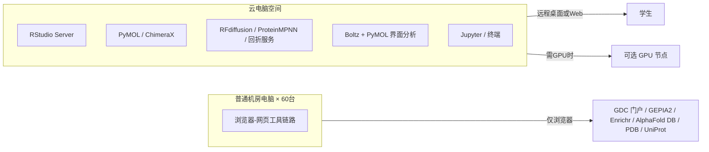

# 环境与部署指南

本指南解决三门课程的"教学环境从哪来"问题，分三条链路：

1. **云电脑空间（主链路）**——已预装全部软件，学生通过远程桌面/浏览器登录使用；
2. **普通机房电脑（备选链路）**——无预装软件、可联网，使用纯网页工具完成大部分实操；
3. **临时云服务器（可选方案）**——若云电脑空间不足以承载整班，可在云服务商临时开设教学服务器。

---

## 一、总体架构



**建议分工**：涉及运算和本地文件（R 分析、PyMOL 可视化、**大分子复合物预测**）一律走云电脑；需要"查/取数据库"的环节（GDC 门户、UniProt、AlphaFold DB、PDB、Enrichr、IMGT）在机房电脑浏览器即可完成，无需挤占云电脑并发。

---

## 二、云电脑软件预装清单

> 说明：版本号为建议值，"必装"为课上直接使用、"推荐"为备选工具的运行时。云电脑请按各表核对安装，未装项按优先级补齐（全部软件均为开源/免费，无商业许可依赖）。

### 2.1 课程一（组学）所需

| 软件 | 版本建议 | 必装/推荐 | 免费替代 |
|---|---|---|---|
| R | ≥ 4.3 | 必装 | — |
| RStudio Server | 最新稳定 | 必装 | 机房浏览器用 Posit Cloud（见下文） |
| Bioconductor 包：`DESeq2`、`clusterProfiler`、`org.Hs.eg.db`、`ReactomePA`、`reactome.db` | 2024 版 | 必装 | 备选链路的 GEPIA2/Enrichr 网页端 |
| CRAN 包：`ggplot2`、`pheatmap`、`dplyr`、`tidyr`、`readr`、`tibble`、`stringr`、`enrichplot` | 最新 | 必装 | — |
| Python（`data/fetch_tcga_luad.py` 只用标准库） | ≥ 3.8 | 必装 | 手动从 GDC 门户下载 |
| 网络访问：`api.gdc.cancer.gov`（下载课程数据） | 在线 | 课前一次 | 教师分发的兜底数据包 |

**验证命令**（云电脑终端或 RStudio 控制台）：

```bash
Rscript -e '
  for (p in c("DESeq2","clusterProfiler","org.Hs.eg.db","ReactomePA","reactome.db",
              "ggplot2","pheatmap","dplyr","tidyr","readr","tibble")) {
    cat(p, requireNamespace(p, quietly=TRUE), "\n") }'
```

全部输出 `TRUE` 即达标。安装方法见附录 A。

### 2.2 课程二（结构）所需

| 软件 | 版本建议 | 必装/推荐 | 免费替代 |
|---|---|---|---|
| PyMOL（开源版即可） | ≥ 2.5 | 必装 | ChimeraX（也可装） |
| UCSF ChimeraX（可选） | 最新 | 推荐 | — |
| 网络访问：UniProt / AlphaFold DB / PDB / InterPro | 在线 | 必装 | 机房浏览器直接访问 |

PyMOL 教学使用说明：直接使用**开源版**（conda-forge 的 `pymol-open-source`，或云电已装好的 `pymol` 环境），无需任何许可；如需教育版以获取部分增强功能，自行与厂商申请（不作课程依赖）。

### 2.3 课程三（AI 大分子药物设计）所需

| 软件 | 版本建议 | 必装/推荐 | 免费替代 |
|---|---|---|---|
| Boltz（蛋白-蛋白复合物回折/复核） | ≥ 2.2 | 推荐 | 在线 ColabFold（多链回折） |
| PyMOL 或 ChimeraX（界面分析、叠合对比） | ≥ 2.5 | 必装 | 云电脑已装 |
| 显卡驱动 + `nvidia-smi` 可用的 GPU | — | 推荐（用于本地Boltz） | 在线 Colab/教师预生成结果 |
| Conda/Mamba（管理 Boltz 环境） | ≥ 23 | 推荐 | — |
| 网络访问：ColabDesign RFdiffusion、ProteinMPNN、ColabFold/在线Boltz | 在线 | 必装或教师预生成 | 教师同参数结果 |
| 网络访问：RCSB PDB、UniProt、abYsis/IMGT | 在线 | 必装 | CDR/链表由教师预填兜底 |

> 课程三不含小分子对接。主线是 EGFR 1YY9 表位约束 → RFdiffusion backbone → ProteinMPNN 序列 → ColabFold/在线 Boltz 回折 → PyMOL 界面复核。在线服务必须课前实测；网页失败时使用教师同参数预生成结果，并在学生报告中标明来源。课程三不依赖商业软件。

### 2.4 云电脑规格建议

| 配置项 | 最低 | 推荐 |
|---|---|---|
| CPU | 4 核 | 8 核 |
| 内存 | 8 GB | 16 GB |
| 磁盘 | 100 GB 系统盘 | 200 GB（Boltz 权重+缓存约 30 GB，见下） |
| GPU | 无（可使用在线服务） | 单张 16–24 GB 显存（如 RTX 3090/4090、A10） |
| 网络 | 校园网出口 | 可访问国际站点（AlphaFold DB、UniProt、Zenodo 等） |

**模型权重与缓存**：本地 Boltz 首次运行会下载权重；RFdiffusion、ProteinMPNN 和回折在线服务的账号/配额/网络也要课前实测。教师必须准备同参数本地结果，避免课堂把等待服务当成教学内容。

---

## 三、网络与浏览器白名单（机房电脑备选链路）

机房电脑仅需一个现代浏览器（Chrome/Edge，避免 IE），并保证可访问以下域名：

| 目的 | 域名 | 用途 |
|---|---|---|
| 数据下载 | `api.gdc.cancer.gov`、`portal.gdc.cancer.gov` | 课程一（TCGA-LUAD 取数，主链路与网页备选） |
| 在线 R | `posit.cloud`（RStudio Cloud）、`rstudio.cloud` | 课程一备选 |
| GEPIA2 | `gepia2.cancer-pku.cn` | 课程一备选（TCGA 差异/生存） |
| Enrichr | `maayanlab.cloud/Enrichr` | 课程一备选（富集） |
| alpha 结构 | `alphafold.ebi.ac.uk`、`files.alphafold.ebi.ac.uk` | 课程二（AlphaFold DB 页面与文件） |
| 序列检索 | `www.uniprot.org` | 课程二 |
| 结构数据库 | `www.rcsb.org`、`files.rcsb.org` | 课程二（页面与 PDB 文件） |
| 结构域 | `www.ebi.ac.uk/interpro` | 课程二 |
| 口袋检测 | `proteins.plus`（DoGSiteScorer）、`fpocket.sourceforge.net`（本地） | 课程二备选 |
| CDR/抗体序列标注 | `www.bioinf.org.uk`（abYsis）、`www.imgt.org`（IMGT/DomainGapAlign） | 课程三（教师预填兜底） |
| 结构数据库/序列 | `www.rcsb.org`、`rest.uniprot.org` | 课程三（1YY9、P00533） |
| 复合物预测（备选） | `colab.research.google.com`、`api.colabfold.com`（ColabFold 的 MSA/预测后端；Colab 注意外网连通性） | 课程三备选 |
| RFdiffusion backbone | `colab.research.google.com`、`app.tamarind.bio` | 课程三在线主链/教师预生成 |
| ProteinMPNN | `colab.research.google.com`、`github.com/dauparas/ProteinMPNN` | 课程三序列设计 |
| 在线 Boltz | `boltz.bio`、`app.tamarind.bio`、`labs.rowansci.com` | 课程三回折/复合物复核 |

> 注意：Google Colab 在国内网络环境下可能不稳定，采用 ColabFold 备选链路前务必在学校网络实测一次；若不可达，直接使用云电脑上的 Boltz。

---

## 四、账号与数据管理

### 4.1 账号方案

| 角色 | 账号 | 说明 |
|---|---|---|
| 教师 | 管理员账号 ×1 | 安装软件、生成数据、分发 |
| 学生 | 每人独立账号 × 选课人数 | 云电脑建议按"学号"命名，便于回收与归档 |
| 备选平台 | Posit Cloud 由教师预建 1 个项目并按课程小节复制 | 机房备选链路时用 |

**口令策略**：教学用途建议统一初始口令，第一节课要求修改；强烈不建议学生账号间共享密码。

### 4.2 云电脑目录约定（部署时建立）

```
/home/teacher/course-data/          # 教师执行：生成与存放课程数据
    ├── course1/                    # 课程一数据（表达矩阵、样本注释、基因注释）
    ├── course2/                    # 课程二素材（PyMOL 脚本、fallback/inputs 与 fallback/expected）
    └── course3-macro/               # 课程三素材（1YY9、序列、CDR 表、在线链接、预生成设计与回折结果）
/home/studentXX/                    # 学生工作目录（每节课要求把产出另存到 U 盘/网盘）
```

课程包仓库目录与部署目录的对应关系（复制时按此改名）：

| 仓库目录 | 部署目录 |
|---|---|
| `course1-omics-target-discovery/` | `course-data/course1/`（数据 CSV 与 `scripts/` 同级） |
| `course2-structure-validation/` | `course-data/course2/` |
| `course3-macro-drug-design/` | `course-data/course3-macro/` |
| `data/` | 课程一数据源（真实 TCGA-LUAD 子集，复制进 `course1/`） |

学生作业统一上传方式：课程包内置"随堂产出打包清单"；建议学校教学平台（学习通/Moodle）作为交作业入口，云电脑不长期保留学生文件。

### 4.3 数据分发与课堂获取

**原则：数据获取是课堂任务的一部分，兜底材料只接住失败，不替代操作。**

- 课程二、课程三的序列与结构数据由学生**在课上现场获取**（UniProt、RCSB PDB、AlphaFold DB、InterPro），并按模板记录来源 URL、访问日期、登录号和 `sha256`。这一步本身是教学内容和考核点，不能由共享目录里的现成文件替代。
- 课程包每个 `materials/` 下都有 `fallback/inputs/`：教师课前从同一来源抓取的副本，附 `README.md`（原始 URL、抓取日期、文件大小、`sha256`）。学生网络失败时可直接使用，但必须在产出中写明"使用兜底文件 + 失败原因"，不得写成自己现场下载。
- `fallback/expected/` 存放每一步的参考输出（链与配体事实、接触残基表、pLDDT 分区统计、CDR 区间等），供学生自查与教师判分；它是参考输出，不是可直接抄写的答案。
- 课程一的表达矩阵与突变表由 `data/fetch_tcga_luad.py` 从 GDC 现场重建（约 128 MB，本机实测首次约 13 分钟，机房受带宽影响可能更久），这是第 0 步的教学内容；整班上课时教师预热一份共享只读缓存（`--cache <共享目录>/gdc_cache`），学生仍逐文件核对 md5，只是不重复占带宽；`data/` 与 `course1-*/materials/fallback/inputs/` 存放同一份已核验副本（`sha256` 见各自 README），网络失败时解压使用。
- 课程三的 RFdiffusion / ProteinMPNN / Boltz 输出依赖 GPU 与在线服务，课程包提供输入模板与生成 runbook；教师必须在课前用自己的账号生成结果并放入 `fallback/`，课上服务不可用时透明分发，学生须在报告中标注来源。

---

## 五、临时云服务器方案（自建替代）

若"云电脑空间"的并发或 GPU 不满足，可在云服务商（阿里云/腾讯云 GPU 实例、AWS EC2 g4dn/机器学习市场镜像）短期租用 1–2 台**带有 GPU** 的实例用于整班教学：

| 步骤 | 操作 |
|---|---|
| 1. 选型 | 4–8 核 CPU + 16 GB 内存 + 单张 16–24 GB 显卡（如 A10）、100 GB 系统盘 + 200 GB 数据盘 |
| 2. 镜像 | Ubuntu 22.04 + 预装 CUDA；或直接使用"生物信息学/药物设计"市场镜像（需核验软件版本） |
| 3. 软件 | 按本指南 2.1–2.3 清单安装（可写一键脚本，见附录 A） |
| 4. 多人复用 | 安装 `rstudio-server`（自带多用户）+ `code-server`（视觉化终端）+ `apache-guacamole` 或 VNC（图形界面，PyMOL/Boltz 结果查看用） |
| 5. 并发 | 大分子预测（Boltz）任务建议教师统一调度（分批跑脚本），避免全班同秒触发 GPU 负载 |
| 6. 备案与回收 | 确认学校网络出口与云厂商合规要求；结课后立即释放实例与快照，防止产生费用与数据残留 |

**费用与时间预算**（供参考，不含折扣）：GPU 实例（如 A10）按小时计费通常为数十元级；三门课+课前演练共建议租用 5–7 天窗口，其中 3 个上课日 + 教师演练与备份 + 冗余一天。若课程包内脚本全部按"演示前置生成、课上复现"策略安排，GPU 实例甚至可以只在课程三当天启用，进一步降低费用。

---

## 六、课前演练（教师必须做的最后一步）

在 [故障排查手册.md](故障排查手册.md) 之外，每个课程的《教师准备清单》都包含"完整走一遍学生流程"项，务必用**学生账号**（权限受限）完整跑通一次，重点验证：

1. 学生能否登录云电脑/打开浏览器访问白名单站点；
2. 示例数据路径是否可读（权限问题最常见）；
3. R 包 / PyMOL / 在线设计链接或预生成结果、1YY9 与 CDR 标注表文件是否在受限账号下可用；
4. 备用链路（网页工具）在同一网络下能否打开；
5. 课时约 180 分钟，**在线服务的等待是否在学生容忍范围内**；超过 3 分钟或不稳定的任务必须有预生成结果和透明标注。

---

## 附录 A：云电脑一键安装脚本（Linux，管理员执行）

```bash
#!/bin/bash
# setup_class_env.sh - provision teaching environment for bio-class
# Run as root/administrator on the cloud machine (Ubuntu 22.04+).

set -euxo pipefail

# ---- 1. base tools ----
apt-get update && apt-get install -y --no-install-recommends \
  build-essential gfortran libcurl4-openssl-dev libssl-dev libxml2-dev \
  libfontconfig1-dev libharfbuzz-dev libfribidi-dev \
  wget curl git vim tmux unzip bzip2 ca-certificates \
  mesa-utils xvfb x11-apps

# ---- 2. R + RStudio Server ----
# (R via r-base repo; RStudio Server deb from posit.co)
wget -qO- https://cloud.r-project.org/bin/linux/ubuntu/marutter_pubkey.asc | gpg --dearmor -o /usr/share/keyrings/r.gpg
echo "deb [signed-by=/usr/share/keyrings/r.gpg] https://cloud.r-project.org/bin/linux/ubuntu jammy-cran40/" > /etc/apt/sources.list.d/r.list
apt-get update && apt-get install -y r-base r-base-dev
wget -q https://download2.rstudio.org/server/jammy/amd64/rstudio-server-latest-amd64.deb
dpkg -i rstudio-server-latest-amd64.deb || apt-get install -f -y

# ---- 3. R packages (run as a normal user after creating accounts) ----
# su teacher -c 'Rscript -e "
#   if (!requireNamespace(\"BiocManager\", quietly=TRUE)) install.packages(\"BiocManager\")
#   BiocManager::install(c(\"DESeq2\",\"edgeR\",\"clusterProfiler\",\"org.Hs.eg.db\"))
#   BiocManager::install(c(\"ReactomePA\",\"reactome.db\"))
#   install.packages(c(\"ggplot2\",\"pheatmap\",\"dplyr\",\"tidyr\",\"tibble\",\"readr\",
#                      \"EnhancedVolcano\",\"stringr\",\"enrichplot\"))"'

# ---- 4. Python + Boltz (GPU) ----
# wget https://repo.anaconda.com/miniconda/Miniconda3-latest-Linux-x86_64.sh
# bash Miniconda3-latest-Linux-x86_64.sh -b -p /opt/conda
# /opt/conda/bin/conda create -n boltz python=3.11 -y
# /opt/conda/bin/conda run -n boltz pip install boltz==2.2.1
# /opt/conda/bin/conda run -n boltz boltz --help   # first run downloads weights

# ---- 5. PyMOL ----
apt-get install -y python3-pymol 2>/dev/null || pip3 install pymol-open-source

echo "Environment setup completed. See bio-class/docs/环境与部署指南.md for verification."
```

> 上表中第 3 步的 R 包安装在正式课时前完成；第 4 步的 Boltz 首次权重下载建议在课前演练时完成（约数 GB，视网络）。

---

## 附录 B：课程数据清单（随课程包分发）

| 文件 | 说明 | 来源/生成方式 |
|---|---|---|
| `data/expression_matrix.csv` | TCGA-LUAD 表达矩阵（60660 基因 × 30 样本，15 肿瘤 vs 15 癌旁） | GDC STAR-Counts 公开文件，`data/fetch_tcga_luad.py` 下载合并（校验值见 `data/README.md`） |
| `data/sample_meta.csv` | 样本注释（condition、sample_type、tss） | 同上（来自 GDC 样本元数据） |
| `data/gene_annotation.csv` | Ensembl gene_id、symbol、gene_type | 同上（来自 STAR-Counts 表头） |
| `data/mutation_status.csv`、`data/mutation_matrix.csv` | 14 个驱动基因的非沉默突变（长表 / 0-1 矩阵） | GDC Masked Somatic Mutation（MAF）提取 |
| `data/sample_manifest.csv`、`data/mutation_manifest.csv` | 锁定的 file_id 与 md5 清单 | GDC 文件元数据（保证可复现） |
| `course1-omics-target-discovery/materials/fallback/inputs/tcga_luad_subset.tar.gz` | 课程一兜底数据包（与 `data/` 逐字节一致） | 由 `data/` 打包 |
| `course2-structure-validation/materials/fallback/inputs/` | 课程二现场下载的兜底副本：`EGFR_P00533.fasta`、`1M17.pdb`、`AF-P00533-F1-model_v6.pdb` | UniProt / RCSB PDB / AlphaFold DB 原始文件（URL 与校验值见目录内 `README.md`） |
| `course2-structure-validation/materials/fallback/expected/` | 课程二各步骤参考输出：结构事实、接触残基、pLDDT 分区统计 | 由兜底输入实际计算 |
| `course3-macro-drug-design/materials/fallback/inputs/` | 课程三兜底副本：`1YY9.pdb`、`P00533.fasta` | RCSB PDB / UniProt 原始文件 |
| `course3-macro-drug-design/materials/fallback/expected/` | 课程三参考输出：链与界面接触表、序列与 CDR 区间 | 由兜底输入实际计算 |
| `course3-macro-drug-design/materials/EGFR_cetuximab_序列.md` | EGFR domain III、cetuximab VH/VL 序列（已填真实序列） | P00533 与 1YY9 SEQRES |
| `course3-macro-drug-design/materials/online_design_links.md` | RFdiffusion、ProteinMPNN、回折服务链接和失败兜底 | 教师课前实测 |
| `course3-macro-drug-design/materials/boltz_antibody_template.yaml` | Boltz 三链参照输入模板（EGFR + Fab light + Fab heavy） | 教师核对 A/C/D 映射后使用 |
| `course3-macro-drug-design/materials/pymol_interface_commands.pml` | 1YY9 界面分析 PyMOL 脚本 | 教师核验链名后分发 |
| `course3-macro-drug-design/materials/CDR标注表.md` | CDR1-3 区间标注（IMGT/PDB 编号） | 由 1YY9 链序列标注，见文件内核验步骤 |
| `course3-macro-drug-design/materials/fallback/expected/design_out/` | RFdiffusion backbone、ProteinMPNN 序列、回折结构 | 教师课前用同一账号、同参数生成（runbook 见 `fallback/README.md`） |

> 版权提示：课程一使用 TCGA-LUAD 数据（NCI GDC 公开层，TCGA 已去标识化、可公开再分发），引用时注明 "TCGA Research Network, https://www.cancer.gov/tcga"；PDB 结构（1M17、1YY9）与序列（UniProt P00533）来源于公开数据库，教学演示引用时注明出处即可。